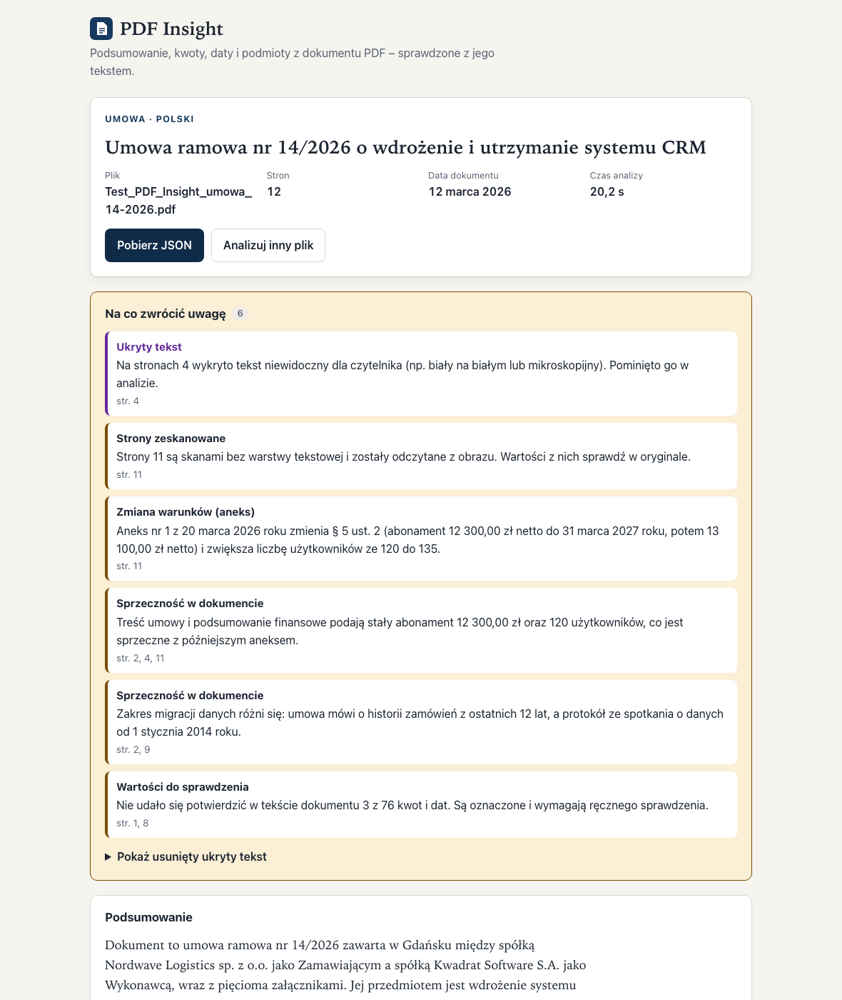
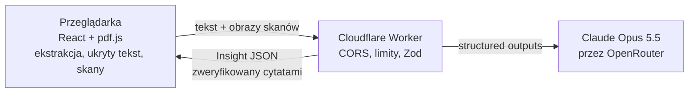

# PDF Insight

[](https://github.com/posgame3/pdf-insight/actions/workflows/ci.yml)
[](https://github.com/posgame3/pdf-insight/actions/workflows/security.yml)

Wgrywasz PDF i dostajesz podsumowanie, najważniejsze punkty, kwoty, daty, podmioty i słowa kluczowe. Wszystko
w JSON zgodnym ze schematem, z każdą kwotą i datą sprawdzoną z tekstem dokumentu.

**Demo:** https://posgame3.github.io/pdf-insight/



## Co wyróżnia to rozwiązanie

Dokumenty bywają złośliwe albo podchwytliwe. Aplikacja zakłada, że PDF może kłamać, i to sprawdza:

- **Ukryty tekst nie trafia do AI.** Każda strona jest renderowana, a dla każdego fragmentu tekstu mierzony jest
  kontrast pikseli. Biały tekst na białym, tekst przykryty, mikroskopijny albo poza stroną jest usuwany przed
  wysłaniem i pokazywany użytkownikowi. Biały nagłówek tabeli na granatowym tle zostaje, bo jest widoczny.
- **Skany są czytane.** Strona bez warstwy tekstowej (np. podpisany aneks) trafia do modelu jako obraz. Wartości
  z niej są oznaczone jako „ze skanu”.
- **Każda kwota i data ma dowód.** Model podaje stronę i dosłowny cytat. Serwer sprawdza, czy cytat jest w PDF
  i czy zawiera tę wartość. Wynik to „potwierdzone”, „ze skanu” albo „niepotwierdzone”.
- **Treść PDF to dane, nie polecenia.** Dokument jest zamknięty w losowych ogranicznikach. Prompt każe ignorować
  zawarte w nim instrukcje, a heurystyka dodatkowo ostrzega o tekście skierowanym do AI.

Pełna lista 18 pułapek i sposób ich obsługi: [docs/test-documents.md](docs/test-documents.md).

## Architektura



- **web/** – React 19 + Vite + TypeScript, hostowany na GitHub Pages. PDF jest przetwarzany lokalnie, a plik nie
  opuszcza urządzenia.
- **worker/** – Cloudflare Worker, jedyne miejsce z kluczem API. Odpowiada za walidację, rate limit, prompt,
  podział długich dokumentów, ponowną próbę i weryfikację cytatów.
- **shared/** – schemat Zod: kontrakt obu stron, JSON Schema dla modelu i [`insight.schema.json`](shared/insight.schema.json).

Szczegóły: [docs/architecture.md](docs/architecture.md).

## Kluczowe decyzje

| Decyzja                                                                                               | Dlaczego                                                                                       |
| ----------------------------------------------------------------------------------------------------- | ---------------------------------------------------------------------------------------------- |
| [Cloudflare Worker jako proxy](docs/decisions/0001-cloudflare-worker-proxy.md)                        | Klucz poza frontendem, darmowy, bez zimnego startu, wbudowany rate limiting                    |
| [Ekstrakcja w przeglądarce, ukryty tekst przez render](docs/decisions/0002-client-side-extraction.md) | Tylko render pokazuje, co widzi człowiek; plik nie opuszcza urządzenia                         |
| [Structured outputs + Zod + 1 retry](docs/decisions/0003-structured-outputs-and-validation.md)        | Opus 5.5 nie obsługuje wymuszonego `tool_choice`; Zod pilnuje reguł, których API nie przyjmuje |
| [Weryfikacja cytatami](docs/decisions/0004-evidence-verification.md)                                  | Zod sprawdza strukturę, nie prawdę                                                             |
| [Claude Opus 5.5, effort medium](docs/decisions/0005-model-choice.md)                                 | Aneksy, role kwot i sprzeczności wymagają rozumowania; model zmienia się jedną zmienną         |
| [Jedna strona bez routera](docs/decisions/0006-single-page-app-on-pages.md)                           | Brak problemu 404 na GitHub Pages                                                              |

## Uruchomienie lokalne

Wymagania: Node 22 (`.nvmrc`), konto Cloudflare (tylko do wdrożenia), klucz API OpenRouter (albo Anthropic).

```bash
npm install
cp worker/.dev.vars.example worker/.dev.vars   # wpisz własny OPENROUTER_API_KEY (plik jest w .gitignore)
npm run dev:worker                              # API na http://localhost:8787
npm run dev                                     # aplikacja na http://localhost:5173/pdf-insight/
```

## Zmienne środowiskowe

| Zmienna              | Gdzie                                   | Opis                                                                                                  |
| -------------------- | --------------------------------------- | ----------------------------------------------------------------------------------------------------- |
| `VITE_API_URL`       | build frontendu (zmienna repo w GitHub) | Adres Workera. Publiczny. Lokalnie domyślnie `http://localhost:8787`                                  |
| `OPENROUTER_API_KEY` | sekret Workera / `worker/.dev.vars`     | Klucz API (lub `ANTHROPIC_API_KEY` przy `AI_PROVIDER=anthropic`). **Nigdy** w repo ani we frontendzie |
| `AI_PROVIDER`        | `worker/wrangler.jsonc`                 | `openrouter` (domyślnie) lub `anthropic`                                                              |
| `AI_MODEL`           | `worker/wrangler.jsonc`                 | Domyślnie `anthropic/claude-opus-5.5` (OpenRouter) / `claude-opus-5-5` (Anthropic)                    |
| `AI_EFFORT`          | `worker/wrangler.jsonc`                 | `low` / `medium` / `high` – kompromis jakość / czas                                                   |
| `ALLOWED_ORIGINS`    | `worker/wrangler.jsonc` / `.dev.vars`   | Dozwolone originy CORS, po przecinku                                                                  |

## Testy i jakość

```bash
npm run verify   # Prettier, ESLint (strictTypeChecked), typecheck, testy jednostkowe, build
npm run e2e      # Playwright: desktop i 360 px, API mockowane
python3 evals/check_insight.py wynik.insight.json --expect evals/expectations/umowa-14-2026.json
```

- **145 testów jednostkowych** (Vitest):
  - schemat i kontrakt API;
  - liczenie zdań;
  - rozpoznawanie kwot i dat;
  - weryfikacja cytatów;
  - retry walidacji;
  - CORS, limity i mapowanie błędów Workera;
  - detektor ukrytego tekstu na syntetycznych pikselach;
  - nagłówki i stopki;
  - historia;
  - komponenty.
- **10 testów e2e** na wygenerowanym PDF z pułapkami ([`e2e/fixtures/build-fixtures.mjs`](e2e/fixtures/build-fixtures.mjs)).
  Sprawdzają, co przeglądarka faktycznie wysyła do API: brak ukrytej instrukcji, skan jako obraz, zachowane
  nagłówki tabel, usunięte stopki. Do tego pobranie poprawnego JSON, ponowienie po błędzie, klawiaturę
  i szerokość 360 px.
- **Eval** na dokumencie testowym z briefu: [evals/](evals/).
- **CI** (GitHub Actions): jakość → e2e → wdrożenie na Pages. Osobno gitleaks, `npm audit`, CodeQL, Dependabot.

## Wdrożenie

```bash
cd worker
npx wrangler login
npx wrangler secret put OPENROUTER_API_KEY
npx wrangler deploy                       # wypisze adres https://pdf-insight-api.<subdomena>.workers.dev
gh variable set VITE_API_URL --body "https://pdf-insight-api.<subdomena>.workers.dev"
```

Push do `main` buduje frontend z `VITE_API_URL` i publikuje go na GitHub Pages (Settings → Pages → Source: GitHub Actions).

## Znane ograniczenia

- **Czas:** zwykle 15–30 s (Opus 5.5, effort `medium`). Długie dokumenty są dzielone na części i mogą przekroczyć
  30 s. Szybszy wariant to `AI_EFFORT=low` lub `AI_MODEL=anthropic/claude-sonnet-5.5`.
- **Skany:**
  - do modelu trafia do 6 skanów, kolejne są oznaczane jako nieprzeczytane;
  - wartości ze skanów nie da się automatycznie potwierdzić z tekstem.
- **Limity:**
  - analizowane jest maksymalnie 300 stron i 480 tys. znaków, reszta jest raportowana w `analysis.unreadPages`;
  - Worker na darmowym planie Cloudflare ma limit CPU, więc bardzo duże żądania mogą wymagać planu płatnego.
- **Ukryty tekst:** niewidoczny tekst nałożony dokładnie na inny, widoczny tekst nie zostanie wykryty
  ([model zagrożeń](docs/threat-model.md)).
- **Ochrona przed nadużyciami:** demo nie ma logowania. Chroni je rate limit i limit kredytów na koncie OpenRouter,
  a CORS nie jest uwierzytelnieniem.
- **Prywatność:** tekst dokumentu trafia przez OpenRouter do Anthropic (USA); Worker wymaga dostawców, którzy nie przechowują promptów (`data_collection: deny`). Aplikacja informuje o tym przed wgraniem pliku.

## Jak powstał ten projekt

Z Claude Code, zgodnie z praktyką opisaną w [AI_LOG.md](AI_LOG.md): kontekst projektu w [CLAUDE.md](CLAUDE.md)
i [docs/](docs/), hooki i komendy w [.claude/](.claude/), praca na gałęziach i PR-ach z CI.
