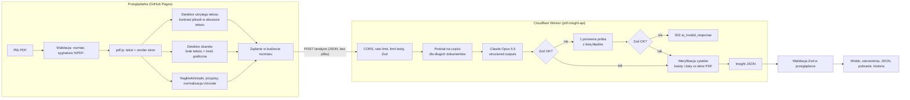

# Architektura

## Dlaczego tak podzielone

- **Ekstrakcja w przeglądarce.** Plik nie opuszcza urządzenia – wysyłamy tylko tekst i obrazy skanów.
  Przeglądarka ma canvas, więc może _zobaczyć_ stronę tak jak człowiek, co jest podstawą wykrywania ukrytego
  tekstu (ADR 0002). Worker dostaje mały JSON zamiast 10 MB PDF.
- **Worker jako jedyne miejsce z kluczem.** Robi wszystko, czemu nie można ufać po stronie klienta: walidację,
  limity, prompt, weryfikację wyniku (ADR 0001).
- **Wspólny pakiet `shared`.** Jeden schemat Zod opisuje kontrakt obu stron i generuje JSON Schema dla modelu.

## Przepływ danych i limity

| Limit                     | Wartość                            | Gdzie                  | Po przekroczeniu                              |
| ------------------------- | ---------------------------------- | ---------------------- | --------------------------------------------- |
| Rozmiar pliku             | 10 MB                              | przeglądarka           | komunikat, brak wysyłki                       |
| Strony analizowane        | 300                                | przeglądarka           | reszta w `analysis.unreadPages` + ostrzeżenie |
| Tekst strony / całości    | 40 tys. / 480 tys. znaków          | przeglądarka + Worker  | reszta w `unreadPages`; Worker odrzuca więcej |
| Skany wysyłane jako obraz | 6 (≤ 900 tys. znaków base64 każdy) | przeglądarka + Worker  | reszta w `unreadPages`                        |
| Body żądania              | 6 MB                               | Worker (strumieniowo)  | 413                                           |
| Zapytania na IP           | 5 / min                            | Worker (Rate Limiting) | 429 + `Retry-After`                           |
| Jedno wywołanie modelu    | do 120 tys. znaków                 | Worker                 | podział na części po 80 tys. + scalanie       |
| Czas analizy              | 85 s (Worker), 95 s (przeglądarka) | oba                    | 504 / komunikat o przekroczeniu czasu         |

## Moduły

| Moduł                              | Odpowiedzialność                                                                |
| ---------------------------------- | ------------------------------------------------------------------------------- |
| `shared/src/schema.ts`             | Schemat wyniku i odpowiedzi modelu, liczenie zdań, kody ostrzeżeń               |
| `shared/src/api.ts`                | Kontrakt żądania, kody i komunikaty błędów                                      |
| `shared/src/text.ts`               | Normalizacja Unicode (NFKC, usuwanie znaków zerowej szerokości i bidi)          |
| `web/src/lib/pdf/extract.ts`       | Orkiestracja ekstrakcji strona po stronie                                       |
| `web/src/lib/pdf/visibility.ts`    | Kontrast w obszarze tekstu, udział „tuszu” na stronie                           |
| `web/src/lib/pdf/textLayout.ts`    | Składanie linii, spacje, przypisy `[1]`                                         |
| `web/src/lib/pdf/repeatedLines.ts` | Usuwanie powtarzających się nagłówków i stopek                                  |
| `web/src/lib/buildRequest.ts`      | Budżet żądania, strony nieprzeczytane                                           |
| `worker/src/index.ts`              | Routing, CORS, rate limit, mapowanie błędów                                     |
| `worker/src/analyze.ts`            | Wywołania modelu, walidacja + retry, scalanie, kompozycja wyniku                |
| `worker/src/grounding/*`           | Rozpoznawanie liczb i dat w cytatach, weryfikacja źródeł                        |
| `worker/src/warnings.ts`           | Ostrzeżenia z ekstrakcji, heurystyka prompt injection, niepotwierdzone wartości |
